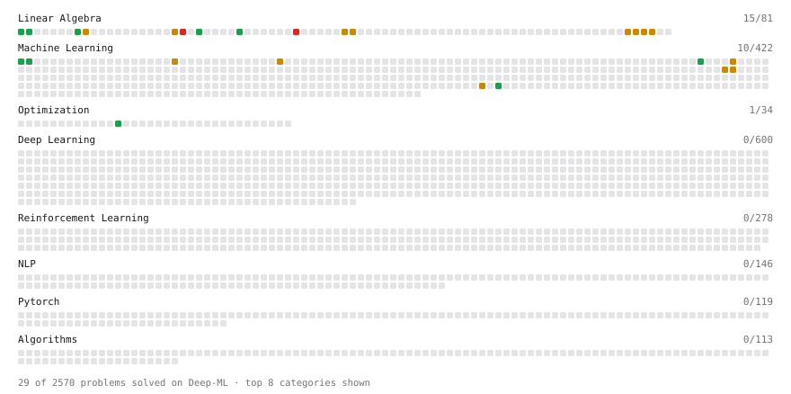

# Deep-ML

My machine learning practice from [Deep-ML](https://www.deep-ml.com). Every solution here was written by hand.

**36** solved · 22 problems · 0 labs · 14 math

[**Browse the interactive portfolio**](https://hugobx11.github.io/deep-ml/) to replay this filling in over time.

## Problems

| | Difficulty | Solved | |
| --- | --- | --- | --- |
| [Calculate 2x2 Matrix Inverse](https://www.deep-ml.com/problems/8) | easy | 2026-11-14 | [solution](problems/0008-calculate-2x2-matrix-inverse) |
| [Derivative of a Polynomial](https://www.deep-ml.com/problems/116) | easy | 2026-11-21 | [solution](problems/0116-derivative-of-a-polynomial) |
| [Dot Product Calculator](https://www.deep-ml.com/problems/83) | easy | 2026-11-14 | [solution](problems/0083-dot-product-calculator) |
| [Gradient Direction and Magnitude](https://www.deep-ml.com/problems/308) | easy | 2026-11-21 | [solution](problems/0308-gradient-direction-and-magnitude) |
| [Implement Orthogonal Projection of a Vector onto a Line](https://www.deep-ml.com/problems/66) | easy | 2026-11-19 | [solution](problems/0066-implement-orthogonal-projection-of-a-vector-onto-a-line) |
| [Linear Regression Using Normal Equation](https://www.deep-ml.com/problems/14) | easy | 2026-11-19 | [solution](problems/0014-linear-regression-using-normal-equation) |
| [Matrix-Vector Dot Product](https://www.deep-ml.com/problems/1) | easy | 2026-11-14 | [solution](problems/0001-matrix-vector-dot-product) |
| [Recursive Least Squares for Simple Linear Regression](https://www.deep-ml.com/problems/1820) | easy | 2026-11-21 | [solution](problems/1820-recursive-least-squares-for-simple-linear-regression) |
| [Transpose of a Matrix](https://www.deep-ml.com/problems/2) | easy | 2026-11-14 | [solution](problems/0002-transpose-of-a-matrix) |
| [Chain Rule for Composite Functions](https://www.deep-ml.com/problems/214) | medium | 2026-11-21 | [solution](problems/0214-chain-rule-for-composite-functions) |
| [Cholesky at Work: Triangular Solves, Log-Determinant and MVN Sampling](https://www.deep-ml.com/problems/1776) | medium | 2026-11-16 | [solution](problems/1776-cholesky-at-work-triangular-solves-log-determinant-and-mvn-sampling) |
| [Cholesky Decomposition](https://www.deep-ml.com/problems/334) | medium | 2026-11-16 | [solution](problems/0334-cholesky-decomposition) |
| [Gaussian Elimination for Solving Linear Systems](https://www.deep-ml.com/problems/58) | medium | 2026-11-15 | [solution](problems/0058-gaussian-elimination-for-solving-linear-systems) |
| [Least-Norm Solution of an Underdetermined System](https://www.deep-ml.com/problems/1777) | medium | 2026-11-16 | [solution](problems/1777-least-norm-solution-of-an-underdetermined-system) |
| [Linear Regression - Power Grid Optimization](https://www.deep-ml.com/problems/92) | medium | 2026-11-21 | [solution](problems/0092-linear-regression-power-grid-optimization) |
| [LU Decomposition of a Square Matrix](https://www.deep-ml.com/problems/333) | medium | 2026-11-16 | [solution](problems/0333-lu-decomposition-of-a-square-matrix) |
| [Matrix times Matrix ](https://www.deep-ml.com/problems/9) | medium | 2026-11-14 | [solution](problems/0009-matrix-times-matrix) |
| [Partial Derivatives of Multivariable Functions](https://www.deep-ml.com/problems/215) | medium | 2026-11-21 | [solution](problems/0215-partial-derivatives-of-multivariable-functions) |
| [Partitioned Inverse via Schur Complements](https://www.deep-ml.com/problems/1775) | medium | 2026-11-15 | [solution](problems/1775-partitioned-inverse-via-schur-complements) |
| [Woodbury, Sherman-Morrison and the Determinant Lemma](https://www.deep-ml.com/problems/1774) | medium | 2026-11-15 | [solution](problems/1774-woodbury-sherman-morrison-and-the-determinant-lemma) |
| [Implement the Conjugate Gradient Method for Solving Linear Systems](https://www.deep-ml.com/problems/63) | hard | 2026-11-16 | [solution](problems/0063-implement-the-conjugate-gradient-method-for-solving-linear-systems) |
| [QR Decomposition](https://www.deep-ml.com/problems/201) | hard | 2026-11-16 | [solution](problems/0201-qr-decomposition) |

## Math

| | Difficulty | Solved | |
| --- | --- | --- | --- |
| [Derivatives and Gradients](https://www.deep-ml.com/math-problems/1) | easy | 2026-11-21 | [solution](math/0001-derivatives-and-gradients) |
| [Gradient Descent Updates](https://www.deep-ml.com/math-problems/5) | easy | 2026-11-21 | [solution](math/0005-gradient-descent-updates) |
| [Matrix Basics](https://www.deep-ml.com/math-problems/9) | easy | 2026-11-14 | [solution](math/0009-matrix-basics) |
| [Vector Operations](https://www.deep-ml.com/math-problems/7) | easy | 2026-11-14 | [solution](math/0007-vector-operations) |
| [Condition Numbers: Why the Determinant Lies About Near-Singularity](https://www.deep-ml.com/math-problems/412) | medium | 2026-11-15 | [solution](math/0412-condition-numbers-why-the-determinant-lies-about-near-singularity) |
| [Inverse and Rank](https://www.deep-ml.com/math-problems/12) | medium | 2026-11-14 | [solution](math/0012-inverse-and-rank) |
| [Least Squares and the Normal Equations](https://www.deep-ml.com/math-problems/34) | medium | 2026-11-19 | [solution](math/0034-least-squares-and-the-normal-equations) |
| [Matrix Multiplication](https://www.deep-ml.com/math-problems/10) | medium | 2026-11-14 | [solution](math/0010-matrix-multiplication) |
| [Multivariate Calculus](https://www.deep-ml.com/math-problems/2) | medium | 2026-11-21 | [solution](math/0002-multivariate-calculus) |
| [Orthogonality and Projections](https://www.deep-ml.com/math-problems/14) | medium | 2026-11-19 | [solution](math/0014-orthogonality-and-projections) |
| [Schur Complements and the Partitioned Inverse](https://www.deep-ml.com/math-problems/409) | medium | 2026-11-14 | [solution](math/0409-schur-complements-and-the-partitioned-inverse) |
| [Solving Linear Systems](https://www.deep-ml.com/math-problems/13) | medium | 2026-11-15 | [solution](math/0013-solving-linear-systems) |
| [Woodbury, Sherman-Morrison and the Matrix Determinant Lemma](https://www.deep-ml.com/math-problems/410) | medium | 2026-11-14 | [solution](math/0410-woodbury-sherman-morrison-and-the-matrix-determinant-lemma) |
| [Matrix Decompositions: LU and QR](https://www.deep-ml.com/math-problems/15) | hard | 2026-11-15 | [solution](math/0015-matrix-decompositions-lu-and-qr) |

---

_This file is regenerated by Deep-ML on every push._
